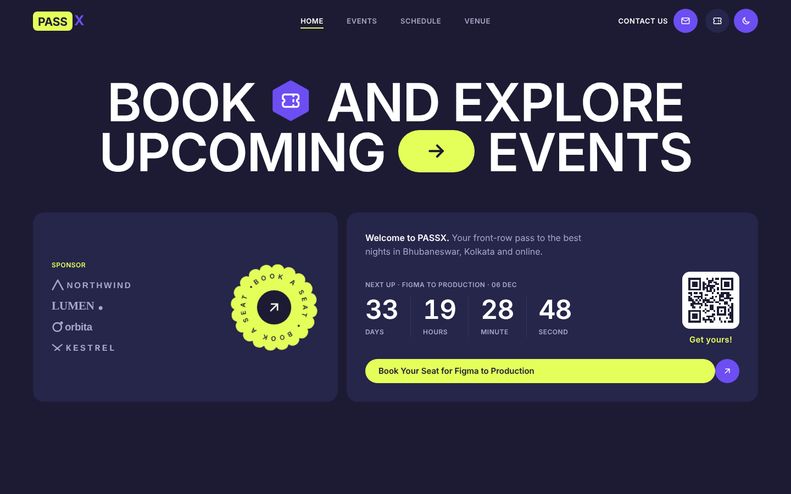
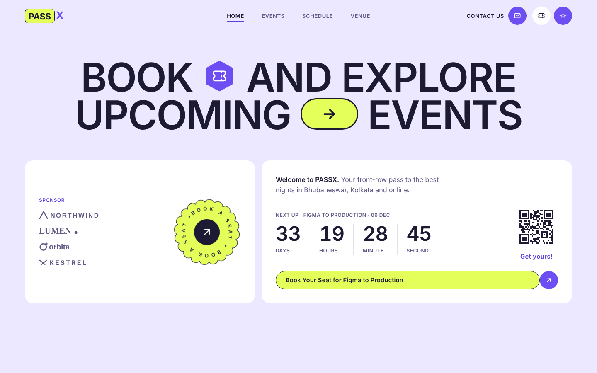
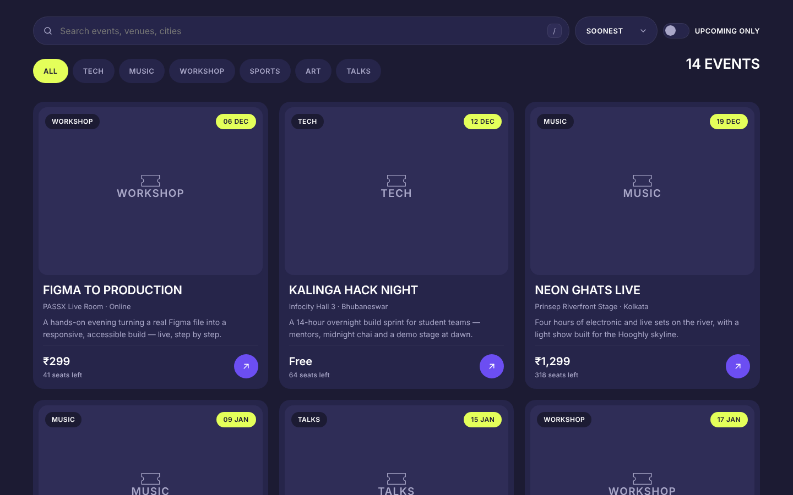
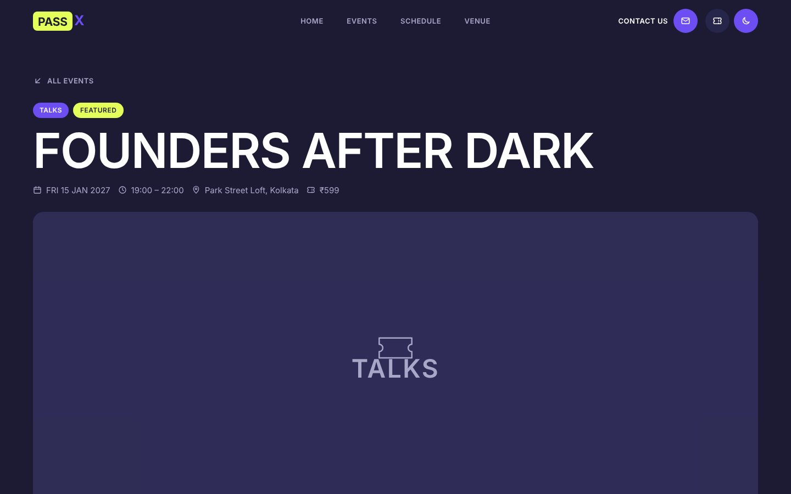
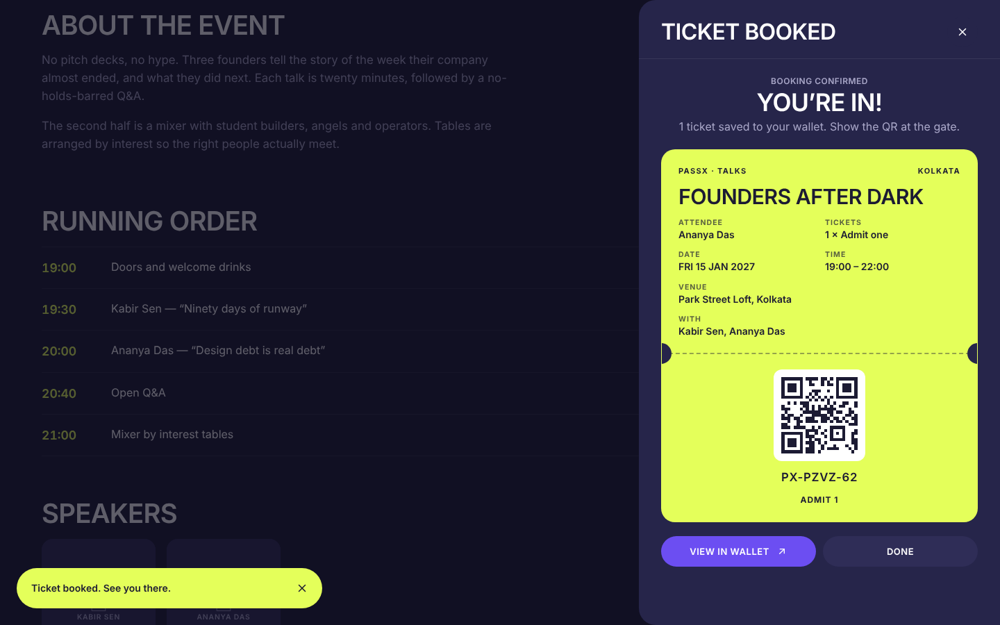
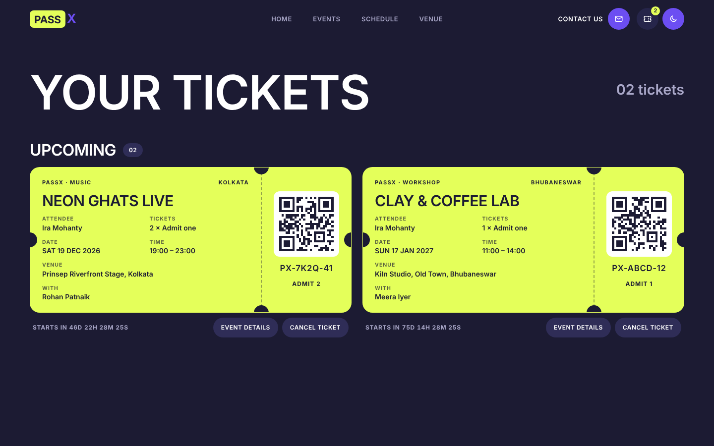
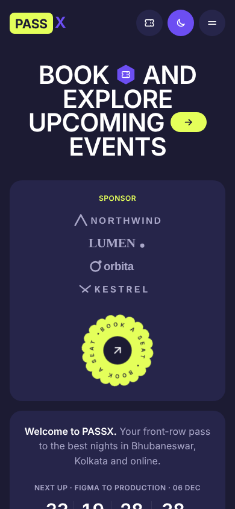
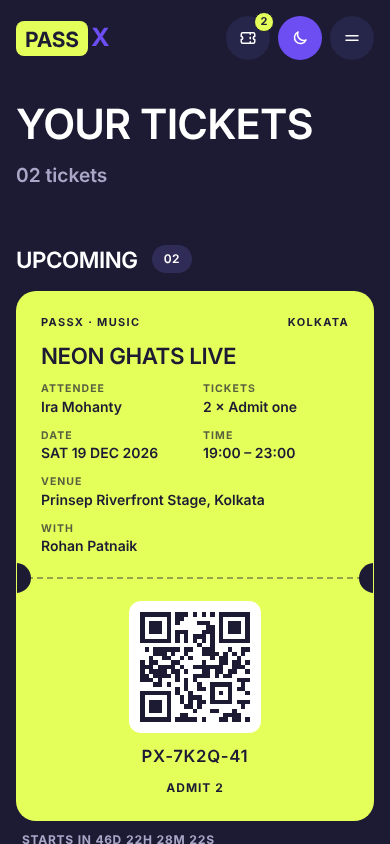

# PASSX

**Book and explore upcoming events — a bold, motion-rich event site with search, booking, QR tickets and a wallet. Built with plain HTML, CSS and JavaScript.**

Live: 

> Built for the **K Explore** web-design task. HTML5, CSS3 and vanilla ES modules: no framework and no build step. The only libraries are GSAP (+ ScrollTrigger, Flip) and Lenis, loaded from public CDNs.

---

## Screenshots

| Home (dark) | Home (light) |
| --- | --- |
|  |  |
| **Event browser** | **Event detail** |
|  |  |
| **Booking success** | **Wallet** |
|  |  |

<p>
  
  
</p>

> The screenshots were captured in an offline sandbox, so the remote fonts and Unsplash photos didn't load. You're seeing the built-in fallbacks: system font, plus labelled placeholder tiles in `--surface-2`. On the live site, photos and Clash Display load normally. Re-capture these after deploying if you want photo-accurate shots.

---

## Design system

Inspired by the *Orbix Studio* event-site shot on Dribbble: a dark navy page with huge extended all-caps headlines, inline icon pills, lime and violet accents, rounded bento cards, a rotating badge and a tilted 3D ticket. Colour comes in flat blocks only, with **no gradients, no glassmorphism and no glows**.

### Palette

| Token | Dark (default) | Light | Use |
| --- | --- | --- | --- |
| `--bg` | `#1C1B33` | `#ECE8FF` | Page |
| `--surface` | `#26254A` | `#FFFFFF` | Cards |
| `--surface-2` | `#2F2D57` | `#F4F1FF` | Inputs, raised/hover, image placeholders |
| `--line` | `rgba(255,255,255,.08)` | `rgba(28,27,51,.12)` | Dividers |
| `--text` | `#FFFFFF` | `#1C1B33` | Body text |
| `--text-muted` | `#A9A7C8` | `#5E5A86` | Secondary text |
| `--lime` | `#E4FF5A` | `#E4FF5A` (+ navy outline) | Primary CTA, logo, highlights, ticket |
| `--lime-ink` | `#1C1B33` | `#1C1B33` | Text on lime |
| `--violet` | `#6C4EF2` | `#6C4EF2` | Secondary buttons, icon pills, arrow circles |
| `--violet-hover` | `#7D62FF` | `#7D62FF` | Hover tint (blended at 50% to keep AA) |
| `--danger` | `#FF6B6B` | `#C2312F` | Validation errors |

Contrast rules: lime is used as **text only on navy/dark surfaces**, or as a **background behind navy text**. In light mode, every lime element gets a navy border. Lime-coloured labels switch to deep violet `#5B3DE0`, the soft red becomes `#C2312F`, and the focus ring becomes navy. All body-text pairs are ≥ 4.5:1.

### Typography

- **Headlines:** *Clash Display* 600/700 (Fontshare), with *Unbounded* (Google Fonts) as fallback. All caps, `letter-spacing: -0.02em`, `line-height: 0.95`. The hero uses `clamp(2.6rem, 7vw, 6rem)`.
- **Body/UI:** *General Sans* (Fontshare), with *DM Sans* as fallback. UI labels are 12–13px uppercase with `0.04em` tracking.
- **Countdowns:** Clash Display 600 with `tabular-nums`.
- Both font hosts are preconnected and use `font-display: swap`.

### Components

| Component | Notes |
| --- | --- |
| **`.cta` (pill + circle)** | A lime pill with navy text butted against a 44px violet circle holding a ↗ arrow. On hover, the circle slides 4px and rotates 45°. The pill grows **exactly 4px**: a `scaleX` on a pseudo-element, with the factor measured per button by `ResizeObserver`. |
| **Secondary button** | A violet pill with white uppercase text and an inline ↗ arrow. The hover tint is an opacity-only overlay. |
| **Headline icon pills** | A violet rounded hexagon with a ticket icon after "BOOK", and a lime → pill before "EVENTS". Both are inline in the `<h1>`. |
| **Rotating badge** | A lime scalloped SVG disc with `BOOK A SEAT •` on a `textPath`, a navy core and a ↗ icon. It spins every 20s, pauses on hover/focus, and scrolls to the events section. |
| **3D ticket** | A lime SVG ticket with notched sides and perforation, tilted −35° over a darker offset copy. It floats, parallaxes on scroll and tilts toward the cursor (max 10°, `perspective: 800px`). |
| **Event card** | A grayscale photo with category and date chips, an uppercase title, venue and city, a two-line description, the price plus seats left, and a ↗ circle. On hover it lifts 6px, the photo turns to colour and the arrow rotates. |
| **Ticket card** | A lime ticket with notches, a dashed perforation, a deterministic QR and a `PX-XXXX-NN` code. It's used for booking success and in the wallet. |
| **Logo** | "PASS" in navy on a lime block, followed by a violet "X". Pure HTML/CSS. |

All icons are inline SVGs with `stroke-width: 2` and round caps. Photos are always `grayscale(1) contrast(1.05)` and turn to colour over 600ms on hover.

---

## Features → task requirements

### Core pages

| Requirement | Where |
| --- | --- |
| Homepage with the reference's section order: nav, hero with sponsor and next-event cards, "Decide to join", the events browser, speakers, a banner and the footer | `index.html`, `js/home.js` |
| Event detail via `?id=`, plus a **"WRONG GATE"** page for unknown ids | `event.html`, `js/event.js` |
| Registration with full JS validation | `js/form.js` |
| Wallet of booked tickets | `wallet.html`, `js/wallet.js` |
| 12 upcoming and 2 past events across 6 categories and 3 cities, 6 speakers and 4 sponsor wordmarks | `js/data.js` |

### Event browser

- **Search:** a pill input with a `/` shortcut and a 200ms debounce. It matches title, category, venue, city and description, and ignores accents.
- **Filters:** multi-select category pills, an "All" pill, a city filter row ("Explore by city +"), and an **Upcoming only** switch.
- **Sort:** Soonest, Price (low to high), or Seats left (fewest first). Past events always sort to the end.
- **URL sync:** search, filter and sort state lives in the query string (`?q=&cat=Tech,Music&city=Kolkata&sort=price&upcoming=1`) and is restored on refresh.
- **Animation:** GSAP **Flip** glides cards to their new positions when the filters change.
- **Empty state:** a lime ticket, "NOTHING ON THE BILL" and a Clear filters button.

### Registration (drawer on desktop, bottom sheet on mobile)

- The panel slides in with GSAP (`power3.out`). Focus is trapped inside, the background is `inert`, Esc or a backdrop click closes it, focus returns to the trigger, and Lenis is paused while it's open. On mobile you can swipe down on the handle to close it.
- **Booking flow:** submitting shows a "BOOKING…" spinner for about 900ms. The form then morphs into the lime ticket, which flips in on the Y axis and settles, with canvas confetti and a toast. The ticket is saved and seats are decremented.
- `event.html?id=…&book=1` opens the drawer straight away. The hero "Book Your Seat for …" CTA uses this.

### Bonus challenges

| Bonus | Implementation |
| --- | --- |
| **Dark/light mode** | Respects `prefers-color-scheme` on the first visit and persists in `localStorage`. An inline head script sets `data-theme` before first paint, so there's no flash. The switch is a **circular clip-path reveal** from the toggle (View Transitions API), with a crossfade fallback. |
| **Countdowns** | Hero (next event), event page (DAYS / HOURS / MINUTE / SECOND, or "THIS SHOW HAS ENDED.") and wallet (a mini countdown per ticket). All run on one shared 1s ticker. |
| **Animations** | See [Motion](#motion). |
| **localStorage** | Tickets, seat overrides, newsletter and theme. Every access is wrapped in `try/catch` and falls back to in-memory storage, so the site keeps working when storage is blocked. |

---

## Tech stack

- **HTML5, CSS3 (custom properties, `clamp()`, grid, `:focus-visible`, View Transitions) and vanilla ES modules.** There's no bundler and nothing to compile, so it deploys as-is.
- **GSAP 3.12.5 + ScrollTrigger + Flip** (cdnjs). GSAP gives frame-accurate, transform-only timelines, scroll-linked reveals and parallax, and Flip layout animation for the filtered grid. All three are free under the standard GSAP licence.
- **Lenis 1.1.13** (jsDelivr) for smooth scrolling (`lerp: 0.1`). It's driven by **GSAP's ticker**, with `lenis.on('scroll', ScrollTrigger.update)`, so scroll-linked animation never drifts out of sync. In-page anchor links scroll through Lenis.
- **Progressive enhancement:** if the CDNs are blocked, the site still renders, filters and books. Animations are skipped, and a 4s safety timer reveals any intro-hidden content.

### Folder structure

```
/index.html          home
/event.html          event detail + registration (?id=)
/wallet.html         my tickets
/css/tokens.css      palette, type scale, radii, motion tokens (dark + light)
/css/base.css        reset, typography, utilities, Lenis CSS, view-transition rules
/css/components.css  nav, menu, CTA, chips, cards, badge, 3D ticket, countdown,
                     drawer, form, toast, modal, footer, cursor, page wipe
/css/pages.css       hero, decide, bento + browser, speakers, banner, event, wallet
/js/data.js          events, speakers, sponsors (fictional)
/js/store.js         guarded localStorage: tickets, seats, newsletter, theme
/js/motion.js        Lenis + GSAP setup, reveals, parallax, 3D ticket, cursor,
                     nav auto-hide, page transitions
/js/ui.js            helpers, escaping, icons, templates, QR, countdowns, toasts,
                     modals, theme toggle, mobile menu, newsletter
/js/home.js          homepage entry
/js/browse.js        search / filter / sort / URL sync / Flip
/js/event.js         event page entry
/js/form.js          booking drawer, validation, success ticket, confetti
/js/wallet.js        wallet entry: groups, cancel + undo
/assets/             favicon.svg, og.png, sponsors/*.svg, screenshots/*.png
```

---

## Validation rules

The form uses `novalidate`, and all checks run in JS. Each field validates **on blur**, then **live** once it has been touched. Errors appear under the field in soft red with a small shake, and the input gets `aria-invalid` plus `aria-describedby`. On a failed submit, focus moves to the first invalid field and an `aria-live` region announces the count (for example, "3 fields need attention…").

| Field | Rule |
| --- | --- |
| Full name | 2–50 chars after trimming; letters (any script), spaces, `.` `'` `-` only; must contain a letter |
| Email | Trimmed and lowercased; `name@domain.tld` pattern |
| Phone | Fixed `+91` chip; spaces and dashes are stripped as you type; exactly 10 digits starting with 6–9 |
| Event | Must be upcoming and have seats left (the select only lists those) |
| Tickets | 1–4 (stepper with − / +), and never more than the seats left |
| Code of conduct | Required checkbox |
| Duplicate | The same email for the same event is rejected with "You already have a ticket for this one", plus a link to the wallet |

---

## localStorage shape

```jsonc
// px.tickets
[
  {
    "code": "PX-7K2Q-41",          // PX-[4 chars, no 0/O/1/I]-[2 digits], unique
    "eventId": "neon-ghats-live",
    "name": "Ira Mohanty",
    "email": "ira@example.com",    // lowercased
    "phone": "+919876543210",
    "qty": 2,
    "bookedAt": "2026-11-02T10:00:00.000Z"
  }
]

// px.seats: overrides the base `seatsLeft` from data.js
{ "neon-ghats-live": 316, "clay-lab": 8 }

// px.newsletter
{ "email": "me@example.com", "subscribedAt": "2026-11-02T10:00:00.000Z" }

// px.theme: a raw string, read by the inline head script before paint
"dark" | "light"
```

Cancelling a ticket restores its seats. **Undo** (in a 5-second toast) puts the ticket back in its original position and takes the seats again. Corrupt or foreign values are ignored safely.

---

## Motion

- **Lenis** smooth scroll site-wide, synced with ScrollTrigger through GSAP's ticker.
- **Hero headline:** words are manually wrapped in spans (no paid SplitText). They rise from 100% inside a clip with a 0.06s stagger, using `power4.out` over 1s. The icon pills pop in with `back.out`, and the hero cards follow.
- **Scroll reveals:** headings and cards rise from `y: 40` with an opacity fade, staggered by 0.08s, once only.
- **Parallax:** the 3D ticket moves `yPercent: -15` and rotates a few degrees. Image tiles sit at `scale(1.15)` and drift inside their frame.
- **Event hero:** a grayscale copy fades out as it scrolls into view, revealing the colour photo (opacity only).
- **Page transitions:** cross-document **View Transitions** are used where supported. A lime layer shows while the old page clips away upward and the new page reveals from below. Elsewhere, a GSAP **lime panel wipes up** on leave and away on enter (about 600ms total). It's bfcache-safe.
- **Custom cursor** (only with `pointer: fine`): a lime dot plus a lerping ring that grows to read **VIEW** over event cards and **BOOK** over CTAs. It's hidden on touch devices.
- **Nav** hides on scroll down and returns on scroll up, or whenever it receives keyboard focus.
- **Performance:** only `transform` and `opacity` are animated, apart from the documented photo `filter` hover. Listeners are passive, and there's no permanent `will-change`. A scripted scroll test measured a steady 16.7ms per frame with no long tasks.

### Reduced motion

With `prefers-reduced-motion: reduce`: Lenis, parallax, the custom cursor, badge rotation, word splits, reveals, confetti, the shake and page wipes are all **disabled**. Content shows instantly, and the drawer and menu open without sliding.

---

## Accessibility

- Semantic landmarks, one `<h1>` per page, and a skip link.
- Visible focus: a 2px lime outline with 3px offset (navy in light mode).
- Every input has a label. Touch targets are at least 44px.
- The drawer, mobile menu and modals trap focus and close with Esc. The background becomes `inert`, and focus returns to the trigger.
- Toasts and the result count live in polite live regions; form errors use an assertive one. Countdowns use `role="timer"`, and seats use `role="meter"`.
- All user-provided text is escaped before it's inserted into HTML.

## Responsiveness

The layout is mobile-first, with breakpoints at **360 / 768 / 1024 / 1440**. Type uses `clamp()`. On mobile, the hero cards, footer and decide section stack and centre like the reference's mobile mockups. A scripted scan at all four widths, in both themes and on all pages, found **no horizontal overflow**.

---

## Run locally

ES modules need a server (not `file://`):

```bash
npx serve .
```

or

```bash
python3 -m http.server 8080
```

Then open <http://localhost:3000> (serve) or <http://localhost:8080>.

## Deploy

### GitHub Pages

1. Push this folder to a GitHub repository (see the commands below).
2. Go to **Settings → Pages → Build and deployment**, choose **Deploy from a branch**, then pick **`main`** and **`/ (root)`**.
3. The site goes live at `https://<user>.github.io/<repo>/`. All paths are relative, so it works from a sub-path.
4. Optional: change `og:image` in the three HTML files to an absolute URL, because some social scrapers ignore relative paths.

### Netlify

- **Drag and drop:** open <https://app.netlify.com/drop> and drop the project folder.
- **From Git:** choose *Add new site → Import from Git*, pick the repo, leave the **build command empty**, and set the **publish directory** to `.`.

---

## Credits

- **Fonts:** [Clash Display](https://www.fontshare.com/fonts/clash-display) and [General Sans](https://www.fontshare.com/fonts/general-sans) by Indian Type Foundry via Fontshare; [Unbounded](https://fonts.google.com/specimen/Unbounded) and [DM Sans](https://fonts.google.com/specimen/DM+Sans) via Google Fonts.
- **Photos:** [Unsplash](https://unsplash.com) contributors.
- **Libraries:** [GSAP](https://gsap.com) (ScrollTrigger, Flip) and [Lenis](https://lenis.darkroom.engineering).
- **Design inspiration:** Orbix Studio on Dribbble.
- All event names, venues, people and sponsor brands are fictional.
